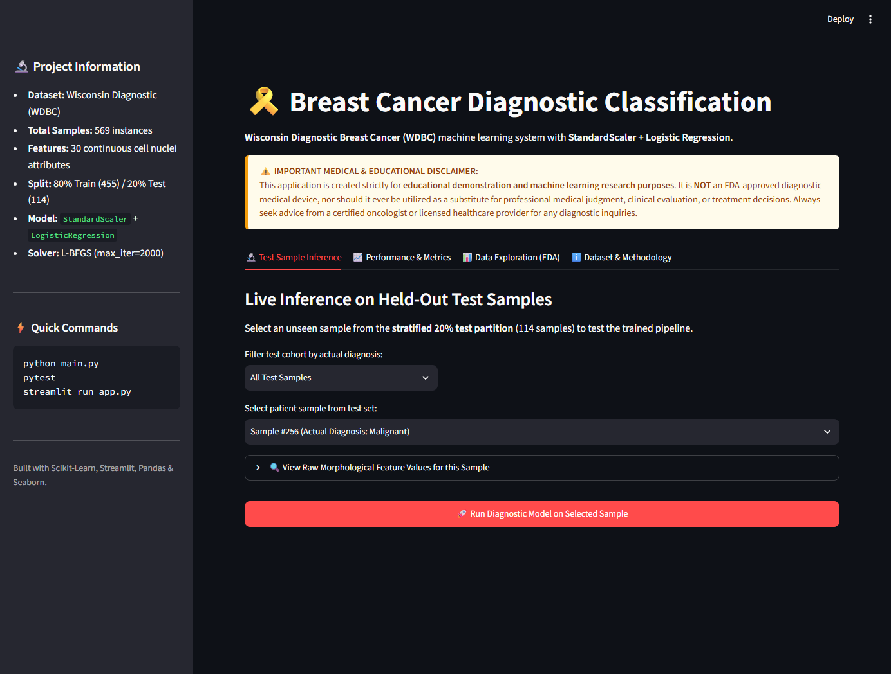
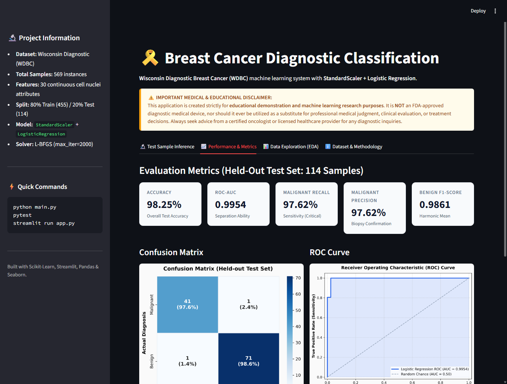

# 🎗️ Breast Cancer Classification: Wisconsin Diagnostic ML Pipeline

An end-to-end, production-grade Machine Learning classification system predicting whether breast masses are **Malignant** or **Benign** based on the Wisconsin Diagnostic Breast Cancer (WDBC) dataset. Built with Python, scikit-learn, pandas, Seaborn, and Streamlit.

[](https://www.python.org/)
[](https://scikit-learn.org/)
[](https://streamlit.io/)
[-brightgreen.svg)](https://pytest.org/)
[](LICENSE)

---

> [!WARNING]
> ### ⚠️ Mandatory Medical & Educational Disclaimer
> **This software is strictly intended for educational, academic demonstration, and scientific research purposes.**  
> It is **NOT** a certified diagnostic medical device, nor has it been approved by the FDA or any medical authority. It must **NEVER** be used to formulate clinical diagnoses, direct patient treatment, or replace certified clinical judgment. Always consult a licensed healthcare practitioner or board-certified oncologist for any health or medical evaluations.

---

## 📌 Project Overview & Objectives

Early and accurate diagnosis of breast cancer significantly improves patient prognosis and survival rates. In clinical practice, fine needle aspiration (FNA) biopsies extract cell samples from breast masses, which are then digitally imaged to capture nuclear characteristics.

The primary objectives of this project are:
1. **Prevent Data Leakage:** Encapsulate preprocessing (`StandardScaler`) and modeling (`LogisticRegression`) inside a scikit-learn `Pipeline`, fitting transformers exclusively on training partitions.
2. **Prioritize Malignant Recall (Sensitivity):** In oncological screening, a **False Negative** (misclassifying a malignant tumor as benign) can be fatal. The pipeline evaluates both classes with explicit emphasis on malignant sensitivity.
3. **Interactive Clinical Demonstration:** Provide a responsive Streamlit web application allowing clinicians and researchers to inspect held-out test cases, review diagnostic probabilities, and assess model decision confidence.
4. **Reproducible Engineering Standards:** Deliver modular code structure, automated test suites via `pytest`, comprehensive exploratory data analysis (EDA), and reproducible artifact persistence.

---

## 📊 Dataset Description & Source

The dataset used is the **Breast Cancer Wisconsin (Diagnostic) Dataset**, natively integrated through `sklearn.datasets.load_breast_cancer`. No manual downloading is required.

- **Origin:** University of Wisconsin Hospitals, Madison (Dr. William H. Wolberg, W. Nick Street, Olvi L. Mangasarian).
- **Total Samples:** 569 patient instances
- **Features:** 30 continuous numeric attributes
- **Target Classes:** 2 categories
  - `0`: **Malignant** (212 samples, 37.26%)
  - `1`: **Benign** (357 samples, 62.74%)
- **Data Quality:** 0 missing values, 0 duplicate records.

### Morphological Feature Breakdown
Ten real-valued characteristics are computed for each cell nucleus:
1. **Radius** (mean of distances from center to points on the perimeter)
2. **Texture** (standard deviation of gray-scale values)
3. **Perimeter** (nuclear boundary length)
4. **Area** (nuclear surface area)
5. **Smoothness** (local variation in radius lengths)
6. **Compactness** ($\frac{\text{perimeter}^2}{\text{area}} - 1.0$)
7. **Concavity** (severity of concave portions of the contour)
8. **Concave Points** (number of concave portions of the contour)
9. **Symmetry** (nuclear symmetry score)
10. **Fractal Dimension** ("coastline approximation" - 1)

For each image, the **Mean**, **Standard Error (SE)**, and **"Worst" (mean of the three largest values)** are recorded, yielding 30 numerical features in total.

---

## 🏗️ Project Architecture & File Structure

```
Breast Cancer Classification/
│
├── main.py                     # Primary pipeline entrypoint (trains, evaluates & creates artifacts)
├── app.py                      # Interactive Streamlit dashboard & diagnostic tool
├── requirements.txt            # Pinned project dependencies
├── README.md                   # Full technical and clinical documentation
├── .gitignore                  # Excludes venvs, caches, checkpoints, and generated binaries
│
├── src/                        # Modular source code
│   ├── __init__.py             # Package initializer
│   ├── data.py                 # Dataset loading, inspection, stratified split, and EDA figure generation
│   ├── train.py                # Pipeline construction (StandardScaler + LogisticRegression) and persistence
│   └── evaluate.py             # Evaluation metrics, confusion matrix, and ROC curve generation
│
├── tests/                      # Automated test suite
│   └── test_model.py           # 11 unit & integration tests (loading, shapes, probabilities, metrics, persistence)
│
├── artifacts/                  # Generated artifacts (created via `python main.py`)
│   ├── model_pipeline.joblib   # Serialized trained scikit-learn Pipeline
│   ├── metrics.json            # Machine-readable performance metrics
│   ├── test_data.csv           # Held-out 20% test partition for live web inference
│   └── dataset_metadata.json   # Dataset dimensions and target label mapping
│
└── reports/
    └── figures/                # Publication-quality charts and plots
        ├── target_distribution.png       # Class balance (bar and donut chart)
        ├── feature_correlations.png      # Pearson correlation matrix of mean cell features
        ├── mean_features_distribution.png# Boxplots of key distinguishing morphological features
        ├── confusion_matrix.png          # Test set confusion matrix with counts and percentages
        └── roc_curve.png                 # Test set ROC curve (AUC = 0.9954)
```

---

## ⚙️ Installation & Setup

### 1. Clone the Repository
```bash
git clone https://github.com/your-username/breast-cancer-classification.git
cd "Breast Cancer Classification"
```

### 2. Set Up a Virtual Environment
Using a virtual environment is strongly recommended:

**On Windows (PowerShell):**
```powershell
python -m venv .venv
.venv\Scripts\Activate.ps1
```

**On macOS / Linux:**
```bash
python3 -m venv .venv
source .venv/bin/activate
```

### 3. Install Dependencies
```bash
pip install -r requirements.txt
```

---

## 🚀 Running the Project

Follow this 3-step workflow to train, test, and run the project:

### Step 1: Train the Model & Generate Artifacts
```bash
python main.py
```
*What this does:*
- Loads the dataset and verifies shape, null values, and class balance.
- Generates exploratory charts under `reports/figures/`.
- Executes an 80/20 stratified train/test split (`random_state=42`).
- Fits a `StandardScaler + LogisticRegression` pipeline exclusively on training data.
- Evaluates performance on held-out test cases and outputs confusion matrix & ROC curve.
- Serializes `model_pipeline.joblib`, `metrics.json`, and `test_data.csv` into `artifacts/`.

### Step 2: Run Automated Unit Tests
```bash
pytest
```
*(Alternative if script directory is not on PATH: `python -m pytest -v`)*

*What this verifies:*
- Dataset loading dimensions and absence of missing values.
- Proper stratified splitting preserving class ratios.
- Pipeline structure, parameter configuration, and convergence.
- Probability predictions are valid ($P \in [0, 1]$ and $\sum P = 1.0$).
- Baseline clinical performance criteria: Accuracy $\ge 95\%$, ROC-AUC $\ge 0.95$, Malignant Recall $\ge 90\%$.
- Model persistence: reloaded pipelines produce bitwise identical predictions.

### Step 3: Launch the Interactive Streamlit Web App
```bash
streamlit run app.py
```
*(Alternative: `python -m streamlit run app.py`)*

Once started, open your web browser at `http://localhost:8501`.

---

## 📈 Methodology & Evaluation Results

### Methodology
1. **Stratification:** An 80/20 stratified train/test split (`random_state=42`) allocates 455 training samples and 114 testing samples while preserving class proportions.
2. **Leakage-Free Feature Scaling:** Features such as `mean area` (range: 143.5 - 2501.0) and `mean smoothness` (range: 0.053 - 0.163) have vastly differing magnitudes. `StandardScaler` standardizes each feature to $\mu = 0, \sigma = 1$. Placing it inside a scikit-learn `Pipeline` ensures test fold statistics never bleed into training.
3. **Linear Decision Boundary:** `LogisticRegression` with `max_iter=2000` and the L-BFGS solver fits a stable, convex optimization surface.

### Empirical Results (Held-Out Test Set: 114 Samples)

| Metric | Score | Clinical Context |
| :--- | :---: | :--- |
| **Overall Accuracy** | **98.25%** | Correct classifications across all 114 unseen test samples. |
| **ROC-AUC Score** | **0.9954** | Exceptional discriminative capacity across all classification thresholds. |
| **Malignant Recall (Sensitivity)** | **97.62%** | **41 of 42 malignant tumors correctly identified** (only 1 false negative). |
| **Malignant Precision** | **97.62%** | High positive predictive value avoids unnecessary surgical procedures. |
| **Malignant F1-Score** | **0.9762** | Harmonized balance between sensitivity and precision for cancer cases. |
| **Benign Specificity (Recall)** | **98.61%** | 71 of 72 benign conditions accurately ruled out. |
| **Macro Average F1** | **0.9812** | Unweighted mean performance across both classes. |
| **Weighted Average F1** | **0.9825** | Support-weighted average metric. |

### Confusion Matrix Breakdown
```
                  Predicted Malignant    Predicted Benign
Actual Malignant          41 (97.6%)            1 (2.4%)      [False Negative]
Actual Benign              1 (1.4%)            71 (98.6%)     [False Positive]
```

---

## 📦 Required Artifacts & Regeneration

The Streamlit web application requires three generated files located in `artifacts/`:
1. `artifacts/model_pipeline.joblib`: The serialized pipeline containing scaling parameters and regression coefficients.
2. `artifacts/metrics.json`: Evaluated metrics used to populate summary KPI cards.
3. `artifacts/test_data.csv`: The held-out 20% test dataset partition used for real-time sample dropdown selection and inference.

If any of these files are absent, the application gracefully alerts the user with instructions:
```bash
python main.py
```
This single command re-runs the full pipeline and regenerates all artifacts deterministically.

---

## 🖼️ Example Screenshots & Interface

To add screenshots of the Streamlit interface to your repository:
1. Run `streamlit run app.py` and capture images of the tabs.
2. Save screenshots into `reports/figures/screenshots/`.
3. Reference them in markdown as shown below:

```markdown
### Web Application Interface

*Interactive test sample selector, live prediction confidence bars, and clinical explanation.*

### Evaluation & Visualizations

*Confusion matrix, ROC curve, and classification report breakdown.*
```

---

## ⚖️ Limitations & Ethical Considerations

1. **Dataset Generalizability:** The WDBC dataset was collected in the 1990s at a single institution. Model weights may not generalize across modern digital imaging protocols, higher-resolution sensors, or diverse patient demographics without domain adaptation.
2. **Asymmetry of Clinical Errors:** In oncology screening, a False Negative is clinically significantly more hazardous than a False Positive. While the model achieves a 97.62% malignant recall, clinical deployment would mandate probability threshold tuning (e.g., lowering the malignant classification threshold from 0.50 to 0.20) to capture borderline suspicious cellular contours.
3. **Black-Box Reliance:** While logistic regression coefficients provide interpretability, automated models should function strictly as second-opinion aids to certified pathologists, never autonomous diagnostic agents.

---

## 🔮 Future Improvements

- [ ] **Cross-Validation Integration:** Implement 10-fold stratified cross-validation alongside the held-out test partition to compute metric confidence intervals.
- [ ] **Hyperparameter Optimization:** Add grid/randomized search or Bayesian optimization across regularization strengths ($C$) and penalties ($L_1, L_2$, ElasticNet).
- [ ] **Feature Selection / Dimensionality Reduction:** Explore PCA (Principal Component Analysis) and Recursive Feature Elimination (RFE) to identify minimal sufficient diagnostic subsets.
- [ ] **Interactive Threshold Slider:** Enable clinicians to dynamically adjust the classification threshold in the Streamlit app to visualize trade-offs between Sensitivity and Specificity in real time.
- [ ] **Model Comparison:** Benchmark Logistic Regression against Support Vector Classifiers (SVC), Random Forests, and XGBoost.

---

## 📜 License
This project is distributed under the MIT License. See [LICENSE](LICENSE) for details.
